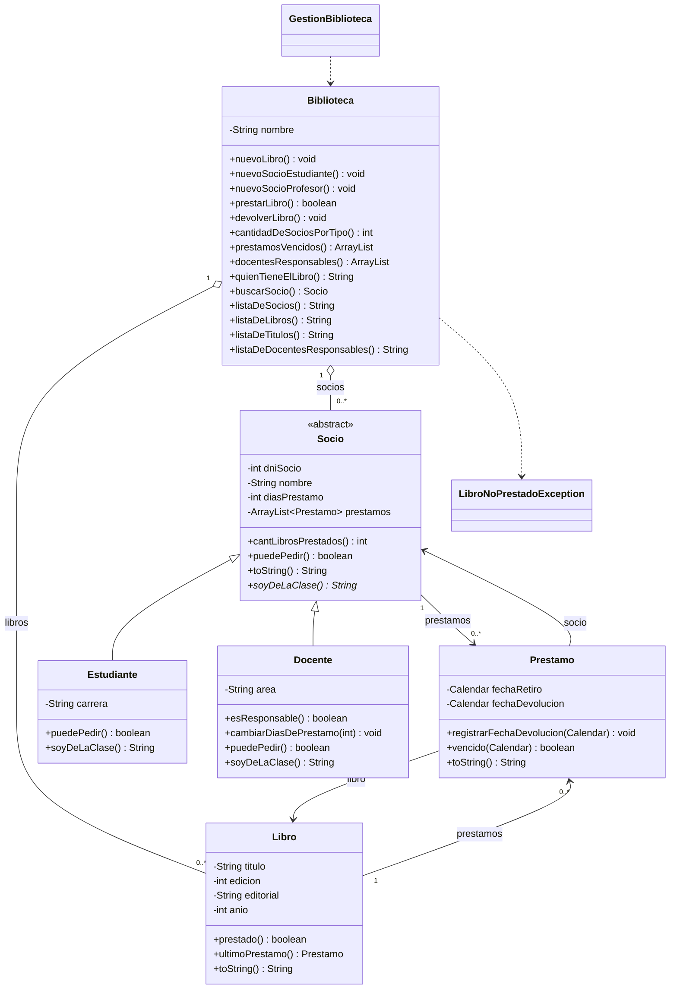

# 📚 Gestión de Biblioteca

Práctico Integrador de **Programación Orientada a Objetos** (Java). Sistema que administra los préstamos de los libros de una biblioteca, con socios de dos tipos (estudiantes y docentes), reglas de préstamo propias de cada tipo e informes para la administración.

- **Equipo:** `[completar nombre del equipo]`
- **Líder:** `[completar]`
- **Grupo de laboratorio:** 3
- **Tablero de trabajo (Trello):** `[completar enlace]`

---

## Índice

1. [Descripción del problema](#1-descripción-del-problema)
2. [Estructura del repositorio](#2-estructura-del-repositorio)
3. [Diagrama de clases](#3-diagrama-de-clases)
4. [Clases del sistema](#4-clases-del-sistema)
5. [Formatos de los listados](#5-formatos-de-los-listados)
6. [Clase GestionBiblioteca (programa principal)](#6-clase-gestionbiblioteca-programa-principal)
7. [Cómo compilar y ejecutar](#7-cómo-compilar-y-ejecutar)
8. [Organización del equipo](#8-organización-del-equipo)
9. [Trabajo con Git](#9-trabajo-con-git)
10. [Consignas de entrega](#10-consignas-de-entrega)

---

## 1. Descripción del problema

Una biblioteca desea administrar los préstamos de sus libros.

- Cada **libro** tiene una ficha de préstamos donde se asientan todos los préstamos realizados.
- Cada **socio** tiene una lista de préstamos donde se asientan los préstamos en su poder.
- Al pedir un préstamo, este se crea solo con la **fecha de retiro**. La biblioteca lo asienta en la ficha del libro y en la del socio. Al devolver el libro, se registra la **fecha de devolución** en el préstamo.

### Tipos de socio

| Tipo | Puede pedir un libro si… | Plazo de devolución |
|---|---|---|
| **Estudiante** | no tiene préstamos vencidos y no supera el límite de libros en su poder | Lo define el constructor de `Estudiante` |
| **Docente** | no tiene ningún préstamo vencido (no tiene límite de cantidad de libros) | 5 días inicialmente. Si es responsable, se le pueden ir agregando días individualmente |

### Informes que necesita la administración

| Informe | Método |
|---|---|
| Cantidad de socios de un tipo dado | `cantidadDeSociosPorTipo(String)` |
| Libros prestados cuyo plazo de devolución está vencido | `prestamosVencidos()` |
| Socio que tiene en su poder un determinado libro | `quienTieneElLibro(Libro)` |
| Títulos que tiene la biblioteca (sin repetir ejemplares) | `listaDeTitulos()` |
| Docentes que devolvieron siempre antes de su vencimiento (o el mismo día) | `docentesResponsables()` / `listaDeDocentesResponsables()` |

---

## 2. Estructura del repositorio

```
.
├── Biblioteca/
│   ├── Biblioteca.java
│   ├── BibliotecaGUI.java
│   ├── Docente.java
│   ├── Estudiante.java
│   ├── GestionBiblioteca.java
│   ├── Libro.java
│   ├── LibroNoPrestadoException.java
│   ├── Prestamo.java
│   ├── README.TXT
│   └── Socio.java
├── .gitignore
├── README.md
└── desktop.ini
```

| Archivo | Descripción |
|---|---|
| `Socio.java` | Clase abstracta base de los socios |
| `Estudiante.java` | Socio de tipo estudiante |
| `Docente.java` | Socio de tipo docente |
| `Prestamo.java` | Préstamo de un libro a un socio |
| `Libro.java` | Libro con su ficha de préstamos |
| `LibroNoPrestadoException.java` | Excepción propia para libros que no están prestados |
| `Biblioteca.java` | Clase que administra los libros y los socios |
| `GestionBiblioteca.java` | Programa principal (`main`) |
| `BibliotecaGUI.java` | Interfaz gráfica del sistema |

---

## 3. Diagrama de clases



---

## 4. Clases del sistema

> Todas las clases usan **doble encapsulamiento**: los atributos son privados y los constructores asignan mediante los `set` (privados), que a su vez son los únicos que escriben el atributo.

### 4.1 `Socio` (abstracta)

Representa a un socio de la biblioteca. Es la superclase de `Estudiante` y `Docente`.

**Atributos**

| Atributo | Tipo | Descripción |
|---|---|---|
| `dniSocio` | `int` | D.N.I. del socio |
| `nombre` | `String` | Nombre y apellido |
| `diasPrestamo` | `int` | Días que tiene el socio para devolver un libro |
| `prestamos` | `ArrayList<Prestamo>` | Préstamos del socio |

**Constructores**

- `Socio(int dni, String nombre, int diasPrestamo)`: inicia la lista de préstamos vacía.
- `Socio(int dni, String nombre, int diasPrestamo, ArrayList<Prestamo> prestamos)`: recibe una lista de préstamos ya existente.

**Métodos**

| Método | Descripción |
|---|---|
| `getDniSocio()`, `getNombre()`, `getPrestamos()`, `getDiasPrestamo()` | Consultas de los atributos |
| `setDiasPrestamo(int)` | Modifica los días de préstamo (público, lo usa `Docente`) |
| `addPrestamo(Prestamo)` | Agrega un préstamo a la lista del socio |
| `removePrestamo(Prestamo)` | Quita un préstamo de la lista del socio |
| `cantLibrosPrestados()` | Cantidad de préstamos en la lista del socio |
| `puedePedir()` | `true` si ninguno de sus préstamos está vencido a la fecha de hoy |
| `toString()` | `D.N.I.: <dni> \|\| <nombre> (<tipo>) \|\| Libros Prestados: <cantidad>` |
| `soyDeLaClase()` | **Abstracto.** Cada subclase devuelve su tipo |

### 4.2 `Estudiante` (extiende `Socio`)

| Elemento | Descripción |
|---|---|
| Atributo `carrera` (`String`) | Carrera que cursa |
| `Estudiante(int dni, String nombre, String carrera)` | Constructor. Fija los días de préstamo del estudiante al llamar a `super(...)` |
| `getCarrera()` | Devuelve la carrera |
| `puedePedir()` | `true` si tiene menos de 3 libros en su poder **y** `super.puedePedir()` (sin préstamos vencidos) |
| `soyDeLaClase()` | Devuelve `"Estudiante"` |

### 4.3 `Docente` (extiende `Socio`)

| Elemento | Descripción |
|---|---|
| Atributo `area` (`String`) | Área en la que se desempeña |
| `Docente(int dni, String nombre, String area)` | Constructor. Todos los docentes inician con **5 días** de préstamo |
| `getArea()` | Devuelve el área |
| `esResponsable()` | `true` si ninguno de sus préstamos está vencido a la fecha de hoy |
| `cambiarDiasDePrestamo(int dias)` | Suma `dias` a los días de préstamo del docente (premio a la responsabilidad) |
| `puedePedir()` | Delega en `Socio.puedePedir()`: un docente no tiene límite de libros, solo no debe tener vencidos |
| `soyDeLaClase()` | Devuelve `"Docente"` |

### 4.4 `Prestamo`

Registra el préstamo de un libro a un socio.

**Atributos:** `fechaRetiro` (`Calendar`), `fechaDevolucion` (`Calendar`, es `null` mientras el libro no se devuelve), `socio` (`Socio`) y `libro` (`Libro`).

**Constructor:** `Prestamo(Calendar fechaRetiro, Socio socio, Libro libro)`. Se crea solo con la fecha de retiro.

| Método | Descripción |
|---|---|
| `getFechaRetiro()`, `getFechaDevolucion()`, `getSocio()`, `getLibro()` | Consultas de los atributos |
| `registrarFechaDevolucion(Calendar)` | Asigna la fecha de devolución |
| `vencido(Calendar fecha)` | `true` si `fecha` es posterior a la fecha de vencimiento (fecha de retiro + `diasPrestamo` del socio) |
| `toString()` | Retiro, devolución (o `N/A` si no se devolvió), título del libro y nombre del socio, en tres líneas |

### 4.5 `Libro`

Libro de la biblioteca con la ficha de todos sus préstamos.

**Atributos:** `titulo`, `edicion` (`int`), `editorial`, `anio` (`int`) y `prestamos` (`ArrayList<Prestamo>`).

**Constructor:** `Libro(String titulo, int edicion, String editorial, int anio)`. Inicia la ficha de préstamos vacía.

| Método | Descripción |
|---|---|
| `getTitulo()`, `getEdicion()`, `getEditorial()`, `getAnio()`, `getPrestamos()` | Consultas de los atributos |
| `agregarPrestamo(Prestamo)` | Asienta un préstamo en la ficha del libro |
| `ultimoPrestamo()` | Devuelve el último préstamo registrado, o `null` si no tiene historial |
| `prestado()` | `true` si el último préstamo todavía no tiene fecha de devolución. Si no hay préstamos, `false` |
| `toString()` | `Titulo: <titulo>` |

### 4.6 `LibroNoPrestadoException`

Excepción propia que extiende `RuntimeException`. Recibe un mensaje descriptivo en el constructor. Se lanza desde `Biblioteca.devolverLibro(...)` cuando se intenta devolver un libro que no está prestado.

### 4.7 `Biblioteca`

Administra la colección de libros y la lista de socios.

**Atributos:** `nombre` (`String`), `libros` (`ArrayList<Libro>`) y `socios` (`ArrayList<Socio>`).

**Constructores**

| Constructor | Uso |
|---|---|
| `Biblioteca(nombre)` | Biblioteca vacía |
| `Biblioteca(nombre, libro)` | Con un libro inicial |
| `Biblioteca(nombre, socio)` | Con un socio inicial |
| `Biblioteca(nombre, libro, socio)` | Con un libro y un socio iniciales |
| `Biblioteca(nombre, libros, socios)` | Con listas ya armadas |

**Altas**

| Método | Descripción |
|---|---|
| `nuevoLibro(titulo, edicion, editorial, anio)` | Crea un libro y lo agrega a la colección |
| `nuevoSocioEstudiante(dni, nombre, carrera)` | Crea un `Estudiante` y lo agrega a los socios |
| `nuevoSocioProfesor(dni, nombre, area)` | Crea un `Docente` y lo agrega a los socios |

**Préstamos y devoluciones**

| Método | Descripción |
|---|---|
| `prestarLibro(Calendar fecha, Socio socio, Libro libro)` | Crea el `Prestamo` y lo agrega a la ficha del libro y a la lista del socio. Devuelve `true` si ambas altas se concretaron |
| `devolverLibro(Prestamo prestamo)` | Busca el préstamo en las fichas de los libros y le asigna la fecha actual como fecha de devolución. Si no lo encuentra, lanza `LibroNoPrestadoException` con el mensaje *"El libro \<título\> no se puede devolver ya que se encuentra en la biblioteca"* |

**Búsquedas e informes**

| Método | Descripción |
|---|---|
| `buscarSocio(int dni)` | Devuelve el socio con ese D.N.I., o `null` si no existe |
| `cantidadDeSociosPorTipo(String tipo)` | Cuenta los socios cuyo `soyDeLaClase()` coincide con `tipo` (sin distinguir mayúsculas) |
| `prestamosVencidos()` | `ArrayList<Prestamo>` con los préstamos vencidos a la fecha de hoy, recorriendo la lista de cada socio |
| `docentesResponsables()` | `ArrayList<Docente>` con los docentes cuyo `esResponsable()` es `true` |
| `quienTieneElLibro(Libro libro)` | Si el libro está prestado, busca el socio que tiene ese préstamo y devuelve un texto con su nombre y D.N.I. Si no está prestado, devuelve un texto avisándolo |

**Listados (devuelven `String`)**

| Método | Descripción |
|---|---|
| `listaDeSocios()` | Listado numerado de socios y, al final, la cantidad de estudiantes y de docentes |
| `listaDeLibros()` | Listado numerado de libros indicando si están prestados |
| `listaDeTitulos()` | Títulos sin repetir (usa un `HashSet<String>`) |
| `listaDeDocentesResponsables()` | Listado de los docentes responsables |

**Getters y setters públicos:** `getNombre/setNombre`, `getLibros/setLibros`, `getSocios/setSocios`.

---

## 5. Formatos de los listados

**Formato 1: Lista de socios**

```
Lista de Socios:

1) D.N.I.: 14524782 || Juan Perez (Docente) || Libros Prestados: 6
2) D.N.I.: 28987498 || Francisco Paenza (Estudiante) || Libros Prestados: 2
**************************************
Cantidad de Socios del tipo Estudiante: 1
Cantidad de Socios del tipo Docente: 1
**************************************
```

**Formato 2: Lista de libros**

```
Lista de Libros:

1) Titulo: JAVA. Como Programar || Prestado: (No)
2) Titulo: Longman. Diccionario Pocket || Prestado: (Si)
```

**Formato 3: Lista de docentes responsables**

```
Lista de Docentes Responsables:

* D.N.I.: 14524782 || Juan Perez (Docente) || Libros Prestados: 6
* D.N.I.: 17982110 || Juan Fernández (Docente) || Libros Prestados: 1
```

**`Prestamo.toString()`**

```
Retiro: 2014/10/15 - Devolución: 2014/10/28
Libro: JAVA. Como Programar
Socio: Juan Perez
```

---

## 6. Clase `GestionBiblioteca` (programa principal)

Contiene el `main`. Crea una biblioteca, la carga con datos de ejemplo y ofrece un menú por consola para operar sobre ella.

### Datos de ejemplo

- **16 libros** (por ejemplo *Código Limpio*, *Effective Java*, *Programando Con JAVA*).
- **4 docentes:** Juan Perez, Juan Fernandez, Maria Alegre y Sebastian Taglia.
- **3 estudiantes:** Francisco Paenza, Cesar Milstein y Karina Leloir.
- **3 préstamos vencidos** (retirados en 2022 y 2023):

| Socio | Libro | Retiro |
|---|---|---|
| Juan Perez | Effective Java | 22/10/2022 |
| Francisco Paenza | Python Crash Course | 22/07/2023 |
| Sebastian Taglia | Programando Con JAVA | 13/12/2023 |

### Menú

| Opción | Acción | Método de `Biblioteca` |
|---|---|---|
| `1` | Agregar socio (estudiante o docente) | `nuevoSocioEstudiante` / `nuevoSocioProfesor` |
| `2` | Agregar libro | `nuevoLibro` |
| `3` | Prestar libro | `prestarLibro` |
| `4` | Devolver libro | `devolverLibro` |
| `5` | Ver préstamos vencidos | `prestamosVencidos` |
| `6` | Lista de docentes que no adeudan libros | `listaDeDocentesResponsables` |
| `7` | Buscar si el libro está prestado | `quienTieneElLibro` |
| `8` | Buscar socio por D.N.I. | `buscarSocio` |
| `9` | Lista de socios | `listaDeSocios` y `cantidadDeSociosPorTipo` |
| `10` | Cantidad de socios por tipo | `cantidadDeSociosPorTipo` |
| `11` | Lista de libros | `listaDeLibros` |
| `0` | Salir | — |

### Preguntas de la consigna y cómo se responden

| Pregunta | Cómo se responde |
|---|---|
| ¿Qué cantidad de socios de tipo Estudiante hay? | `cantidadDeSociosPorTipo("Estudiante")` |
| ¿Cuál es la lista de docentes que nunca han adeudado ni adeudan libros? | `listaDeDocentesResponsables()` |
| ¿Cuál es la lista de libros? ¿Y la de socios? | `listaDeLibros()` y `listaDeSocios()` |
| ¿Qué socio tiene prestado el libro "Programando con JAVA"? | `quienTieneElLibro(libro)` |

---

## 7. Cómo compilar y ejecutar

**Requisito:** Java 8 o superior (JDK).

### Con BlueJ

1. Abrir BlueJ y elegir *Proyecto → Abrir proyecto…*, seleccionando la carpeta `Biblioteca`.
2. Compilar con el botón **Compilar**.
3. Clic derecho sobre la clase `GestionBiblioteca` y elegir `void main(String[] args)`.

### Con la terminal

Desde la carpeta que contiene a `Biblioteca/`:

```bash
javac Biblioteca/*.java
java Biblioteca.GestionBiblioteca
```

---

## 8. Organización del equipo

El equipo se dividió en cuatro subgrupos que trabajaron de forma independiente, y la clase `GestionBiblioteca` se resolvió entre los seis integrantes.

| Subgrupo | Clases | Integrantes |
|---|---|---|
| Primero | `Prestamo`, `Socio` | `[completar]` |
| Segundo | `Estudiante`, `Docente` | Gomez Varela, Verónica |
| Tercero | `Libro` | Villagra, Facundo Nahuel |
| Cuarto | `Biblioteca` | Sapio, Luciano · Romero, Agustín · Veglia, Marcos |
| Equipo completo | `GestionBiblioteca` | Los seis integrantes |

La planificación y el seguimiento de tareas se hicieron con **Trello**.

---

## 9. Trabajo con Git

<!-- Reemplazar o completar con los pasos que el equipo ya tiene en el README.TXT -->

Flujo básico para trabajar en equipo:

```bash
git clone <url-del-repositorio>     # una sola vez, para descargar el proyecto
git pull                            # antes de empezar a trabajar: traer los cambios del resto
git add <archivo>                   # agregar los archivos modificados
git commit -m "mensaje descriptivo" # guardar los cambios con un mensaje claro
git push                            # subir los cambios al repositorio
```

Cada subgrupo modifica solo las clases que le corresponden, para evitar conflictos al hacer *merge*.

---

## 10. Consignas de entrega

- **Entrega:** proyecto **BlueJ** comprimido en un `.zip` más la ficha de autoevaluación.
- **Nombre del archivo:** `NombreEquipo_PracticoIntegrador.zip`
- **Dónde:** Aula Virtual, en la tarea creada para cada grupo de laboratorio. **Todos** los integrantes deben realizar la entrega.
- **Fecha límite:** 09/11.
- **Evaluación:** coloquio. Será individual (preguntas sobre las clases que implementó cada uno) y grupal (sobre `GestionBiblioteca`, el dominio del problema y los conceptos del paradigma aplicados).
- **Requisitos técnicos:** usar colecciones genéricas y mantener todas las clases dentro de un mismo paquete.
